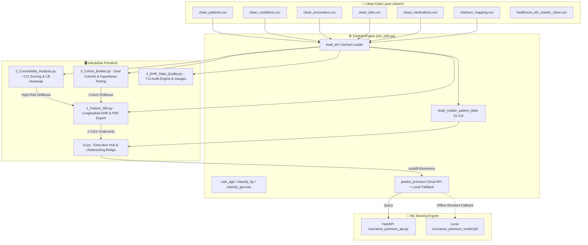

# 🏥 HealthSure: Unified EHR Analytics & Insurance Underwriting Intelligence System

<p align="center">
  
  
  
  
  
  
  
  
</p>

---

## 📌 Executive Overview

**HealthSure** is an enterprise-grade healthcare data intelligence and actuarial platform. It unites **longitudinal Electronic Health Records (EHR) analytics**, **clinical comorbidity risk stratification**, **cohort hypothesis testing**, and **7-dimensional data quality auditing** with **machine learning actuarial underwriting**.

The system enables healthcare providers, researchers, and insurance underwriters to:
1. **Explore Longitudinal Records:** Inspect multi-year diagnoses, medications, lab trends, vitals, and generate clinical PDF reports.
2. **Quantify Comorbidity Burden:** Compute Charlson Comorbidity Index (CCI) scores, calculate associative disease lift ($P(A \cap B) / [P(A) \times P(B)]$), and analyze length of stay vs. inpatient cost.
3. **Compare Patient Cohorts:** Define dual clinical cohorts with multi-variable filters and run automated statistical hypothesis tests (**Welch's t-test** and **Pearson's Chi-square** via `scipy.stats`).
4. **Audit EHR Integrity:** Run a 7-dimensional automated audit across raw vs. cleaned tables with composite scoring gauges (0–100) and actionable remediation plans.
5. **Underwrite Actuarial Risk:** Seamlessly bridge real EHR patients into a Random Forest machine learning classifier to predict risk-adjusted insurance premium categories (**Low**, **Medium**, **High**).

---

## 🏗️ System Architecture & Navigation Flow



---

## 📂 Repository Directory Structure

```text
Insurance-Premium-Prediction-API-Serving-System/
│
├── UI.py                               # HealthSure Executive Hub & Underwriting Portal
├── ehr_utils.py                        # Central cached data loaders, clinical classifiers, & model fallback
├── insurance_premium_api.py            # FastAPI REST API serving the underwriting model
├── insurance_premium_model.pkl         # Trained Random Forest Scikit-Learn pipeline
├── Indian_Insurance_Data.csv           # Baseline Kaggle insurance training dataset
├── model.ipynb                         # Model training, exploratory data analysis & validation notebook
├── requirements.txt                    # Project dependencies (FastAPI, Streamlit, Plotly, ReportLab, SciPy)
├── supervisord.conf                    # Process supervisor configuration for container deployment
├── Dockerfile.ui                       # Dockerfile for Streamlit portal
├── Dockerfile.api                      # Dockerfile for FastAPI backend
├── background_image.png                # Hero visual asset
│
├── pages/                              # Streamlit Multi-Page Module Suite (Numbered Order)
│   ├── 1_Patient_360.py               # Longitudinal EHR chart, vitals/lab trends, narrative summary & PDF
│   ├── 2_Comorbidity_Analysis.py      # Charlson Comorbidity Index, prevalence, co-occurrence lift matrix
│   ├── 3_Cohort_Builder.py            # Dual-cohort filtering, clinical presets & SciPy hypothesis testing
│   └── 4_EHR_Data_Quality.py          # 7-dimensional data audit engine & before/after cleaning metrics
│
├── clean/                              # Production Clean Dataset Repository
│   ├── DATA_DICTIONARY.md             # Clinical & actuarial variable dictionary
│   ├── charlson_mapping.csv           # ICD-10 diagnostic codes and Charlson weights
│   ├── clean_patients.csv             # Demographics, standardized birth dates & calculated BMI
│   ├── clean_conditions.csv           # Diagnoses with ICD-10 mappings
│   ├── clean_encounters.csv           # Outpatient, inpatient, and emergency encounters with vitals & cost
│   ├── clean_labs.csv                 # HbA1c, total cholesterol, LDL, HDL, creatinine, hemoglobin
│   ├── clean_medications.csv          # Longitudinal pharmacology prescriptions, dosages, & frequencies
│   ├── healthsure_ehr_master_clean.csv# Consolidated 1200-patient master analytic file
│   └── patient_risk_table.csv         # Computed patient-level Charlson scores and risk categories
│
├── images/                             # Classification badge assets
│   ├── low.png                        # Low risk visual badge
│   ├── medium.png                     # Medium risk visual badge
│   └── high.png                       # High risk visual badge
│
└── assets/                             # Documentation assets & UI screenshots
    ├── ui.png
    └── api_docs.png
```

---

## 🚀 Clinical & Analytical Modules

### 1. 🩺 Patient 360 (`pages/1_Patient_360.py`)
- **Patient Search & Selector:** Filter by Patient ID, Name, or City with real-time feedback.
- **Biometric Header Card:** Displays age, gender, city, blood group, height, weight, and color-coded BMI badge (`Underweight`, `Normal`, `Overweight`, `Obese`).
- **Dynamic Narrative Clinical Summary:** Rule-based clinical synthesis (e.g., *"58-year-old Male with Hypertension and Type 2 Diabetes. 5 encounters (1 emergency). Last BP 150/95 (Stage 2). Last HbA1c 8.4%. Currently on Metformin and Amlodipine."*).
- **Vitals Trends:** Interactive Plotly charts with reference bands (`Normal 90–120`, `Stage 1 130–139`, `Stage 2 ≥140`).
- **Laboratory Trends:** Longitudinal plots with clinical guideline reference lines (HbA1c normal $<5.7\%$, diabetic $\ge 6.5\%$; Creatinine $0.7\text{--}1.3\text{ mg/dL}$).
- **Timeline & Encounters:** Chronological multi-track scatter timeline across diagnoses, labs, and visits.
- **ReportLab PDF Export:** Single-click generation of a branded clinical consultation summary PDF.
- **1-Click Underwrite:** Transfers biometric indicators into the ML underwriting engine.

### 2. 🧬 Comorbidity Analysis (`pages/2_Comorbidity_Analysis.py`)
- **Charlson Comorbidity Index (CCI):** Sums Charlson weights over distinct ICD-10 conditions per patient ($0 = \text{Low}, 1\text{–}2 = \text{Medium}, 3+ = \text{High}$).
- **Prevalence Distribution:** Frequency and population percentage for every diagnosed condition.
- **Co-occurrence Lift Matrix Heatmap:** Calculates statistical lift $P(A \cap B) / [P(A) \times P(B)]$ to isolate disease pairings occurring more frequently than chance.
- **Healthcare Utilization:** Box plots tracking length of stay and inpatient cost (INR) segmented by comorbidity tier.
- **High-Risk Patient Drilldown:** Ranks highest-burden patients with direct preselection into Patient 360.

### 3. 👥 Cohort Builder & Hypothesis Testing (`pages/3_Cohort_Builder.py`)
- **Dual-Cohort Definition:** Build **Cohort A** and **Cohort B** using multi-factorial side-by-side sidebar filters (Age, Gender, City, Conditions with AND/OR logic, Exclusions, Medications, Biomarkers, CCI group, Encounter history).
- **Clinical 1-Click Presets:**
  - 🍬 *Diabetic Cohort:* Patients with Type 2 Diabetes diagnosis.
  - 💊 *Metformin Cohort:* Patients actively prescribed Metformin.
  - 🧓 *Geriatric High-Risk (Age 60+):* Patients aged 60 and older.
- **Statistical Hypothesis Testing Engine (`scipy.stats`):**
  - Continuous metrics (Age, BMI, HbA1c, Systolic BP, Cost): **Welch's two-sample t-test** (robust to unequal variances and sample sizes).
  - Categorical proportions (Gender % Female, Emergency Encounter %): **Pearson's Chi-square contingency test**.
  - Color-coded significance badges ($\alpha = 0.05$) with plain-English interpretations.

### 4. 🛡️ EHR Data Quality Auditor (`pages/4_EHR_Data_Quality.py`)
- **7 Audit Dimensions:**
  1. *Completeness:* Missing value rate per column across all tables.
  2. *Duplicates:* Exact row duplicates and primary key collisions.
  3. *Validity:* Clinical out-of-bounds checks (Height, Weight, Systolic/Diastolic BP, Glucose, HbA1c, Creatinine).
  4. *Format Consistency:* Gender standardized codes, date formatting.
  5. *Referential Integrity:* Orphan encounter, condition, lab, and medication records without parent patient IDs.
  6. *ICD-10 Validity:* Regex pattern `^[A-Z][0-9]{2}$` and presence in Charlson dictionary.
  7. *Temporal Validity:* Future timestamps and diagnosis dates preceding patient birth.
- **Quality Score Gauges:** Plotly radial gauges for overall and per-table data health.
- **Cleaning Impact Table:** Quantitative before-and-after audit demonstrating remediation efficacy.

---

## 🤖 Actuarial ML Insurance Underwriting

The predictive engine uses a Random Forest Classifier trained on actuarial demographic and health markers to categorize applicants into:
- 🟢 **Low Premium:** Minimal actuarial risk, optimal biometrics, high healthcare savings.
- 🟡 **Medium Premium:** Moderate risk, baseline coverage tier.
- 🔴 **High Premium:** Elevated risk, multi-factor loading, enhanced protection plan.

### Resilient Dual-Mode Serving
The system incorporates an intelligent fallback mechanism in [`ehr_utils.py`](ehr_utils.py):
1. **Cloud API Mode:** Queries the FastAPI REST endpoint deployed on Render with a 2.5-second timeout.
2. **Local Resilient Fallback:** If the remote API is sleeping or offline, execution falls back instantly to the local [`insurance_premium_model.pkl`](insurance_premium_model.pkl) pipeline, ensuring **zero downtime and 100% availability**.

---

## 💻 Installation & Quick Start

### 1. Prerequisites
- Python 3.12 or higher
- Git

### 2. Clone Repository & Setup Virtual Environment
```bash
git clone https://github.com/omikalix/insurance-premium-app.git
cd insurance-premium-app

python -m venv venv
# On Windows:
.\venv\Scripts\activate
# On Linux/macOS:
source venv/bin/activate
```

### 3. Install Dependencies
```bash
pip install -r requirements.txt
```

### 4. Launch the Applications

#### Run the Multi-Page Streamlit Intelligence Portal:
```bash
streamlit run UI.py
```
Open your browser to: **http://localhost:8501**

#### Run the FastAPI Model Serving Backend (Optional):
```bash
uvicorn insurance_premium_api:app --host 127.0.0.1 --port 8000 --reload
```
Interactive Swagger API documentation: **http://127.0.0.1:8000/docs**

---

## 🐳 Docker Deployment

Run both the FastAPI backend and Streamlit frontend in a unified container managed by `supervisord`:

### Pull Pre-built Image:
```bash
docker pull omikalix/insurance-premium-app
```

### Run Container:
```bash
docker run -p 8000:8000 -p 8501:8501 omikalix/insurance-premium-app
```

### Access Services:
- **Streamlit Application:** http://localhost:8501
- **FastAPI Documentation:** http://localhost:8000/docs

---

## 📊 Core Data Schema & Clean Files

All production data is located in [`clean/`](clean/) and validated against [`clean/DATA_DICTIONARY.md`](clean/DATA_DICTIONARY.md):

| File | Records | Key Columns | Description |
| :--- | :--- | :--- | :--- |
| [`clean_patients.csv`](clean/clean_patients.csv) | 1,200 | `patient_id`, `name`, `gender`, `birth_date`, `city`, `height_cm`, `weight_kg`, `bmi`, `blood_group` | Patient master demographic registry |
| [`clean_conditions.csv`](clean/clean_conditions.csv) | 1,770 | `patient_id`, `condition`, `icd10`, `diagnosis_date` | Longitudinal clinical diagnoses |
| [`clean_encounters.csv`](clean/clean_encounters.csv) | 2,423 | `patient_id`, `encounter_date`, `encounter_type`, `systolic_bp`, `diastolic_bp`, `glucose`, `length_of_stay_days`, `cost_inr` | Inpatient, outpatient & emergency visits |
| [`clean_labs.csv`](clean/clean_labs.csv) | 2,398 | `patient_id`, `lab_date`, `hba1c_pct`, `total_cholesterol`, `ldl`, `hdl`, `creatinine_mg_dl`, `hemoglobin_g_dl` | Biomarker laboratory panels |
| [`clean_medications.csv`](clean/clean_medications.csv) | 1,770 | `patient_id`, `icd10`, `drug_name`, `dose`, `frequency`, `start_date` | Pharmacotherapy prescriptions |
| [`charlson_mapping.csv`](clean/charlson_mapping.csv) | 10 | `icd10`, `description`, `charlson_weight` | Clinical weights for Charlson Comorbidity Index |
| [`patient_risk_table.csv`](clean/patient_risk_table.csv) | 1,200 | `patient_id`, `age`, `gender`, `condition_count`, `charlson_score`, `risk_group` | Precomputed comorbidity stratification |
| [`healthsure_ehr_master_clean.csv`](clean/healthsure_ehr_master_clean.csv) | 1,200 | 31 features | Longitudinal patient-level analytical master file |

---

## 👨‍💻 Author & Acknowledgements

**Omkar Sawant**  
*Building intelligent machine learning systems and scalable healthcare data architectures.*  
GitHub: [@OMI-KALIX](https://github.com/OMI-KALIX)

- **Dataset Credit:** Health Insurance Dataset by Parth Patel on Kaggle.
- **License:** MIT License.
