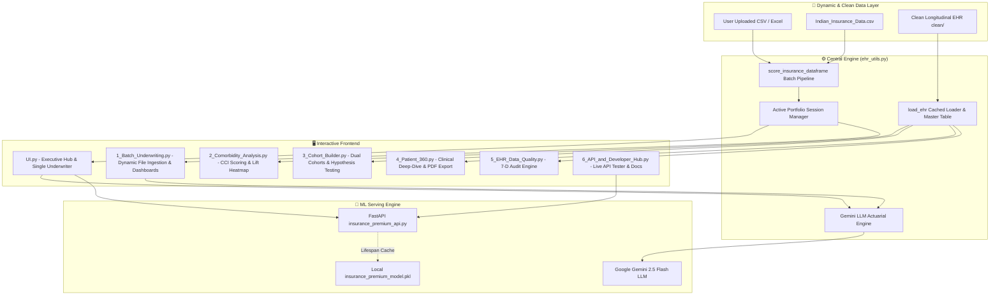

# 🏥 HealthSure InsurTech: Unified AI Underwriting & Health Actuarial Intelligence System

<p align="center">
  
  
  
  
  
  
  
  
</p>

---

## 📌 Executive Overview

**HealthSure InsurTech** is a comprehensive healthcare data intelligence and actuarial risk platform. It unites **machine learning actuarial underwriting**, **dynamic batch file ingestion (CSV/Excel)**, **Google Gemini LLM executive risk intelligence**, and **longitudinal Electronic Health Records (EHR) analytics** into an intuitive multi-module system.

The platform enables insurers, actuaries, and evaluators to:
1. **Underwrite Single Applicants:** Predict risk-adjusted insurance premium tiers (**Low**, **Medium**, **High**) with real-time biometric readouts ($BMI$, $HRI$) and automated Google Gemini actuarial briefs.
2. **Batch Underwrite Entire Portfolios:** Upload custom `.csv` or `.xlsx` policyholder files, trigger high-throughput asynchronous machine learning scoring with live progress bars, and dynamically render interactive Plotly analytics.
3. **Analyze Clinical Comorbidity Burden:** Compute Charlson Comorbidity Index (CCI) scores, calculate associative disease lift ($P(A \cap B) / [P(A) \times P(B)]$), and analyze length of stay vs. inpatient cost.
4. **Compare Patient Cohorts:** Define dual clinical cohorts with multi-variable filters and run automated statistical hypothesis tests (**Welch's t-test** and **Pearson's Chi-square** via `scipy.stats`).
5. **Audit Longitudinal Records (Patient 360):** Deep-dive into high-risk applicants with multi-year diagnoses, lab trends, and 1-click clinical PDF export.
6. **Inspect REST API & Model Diagnostics:** Live FastAPI endpoint tester (`/predict`, `/predict/batch`), feature importance ranking, and ready-to-run code snippets in Python, cURL, and JavaScript.

---

## 🏗️ System Architecture & Workflow



---

## 📂 Repository Directory Structure

```text
Insurance-Premium-Prediction-API-Serving-System/
│
├── UI.py                               # Executive Hub & Single Applicant Underwriter
├── ehr_utils.py                        # Central batch scoring, portfolio manager & Gemini client
├── insurance_premium_api.py            # FastAPI REST API serving the underwriting model
├── insurance_premium_model.pkl         # Trained Random Forest Scikit-Learn pipeline
├── Indian_Insurance_Data.csv           # Baseline Kaggle insurance dataset (4,000 records)
├── model.ipynb                         # Model training, exploratory data analysis & validation notebook
├── requirements.txt                    # Project dependencies (FastAPI, Streamlit, Plotly, ReportLab, SciPy, GenAI)
├── supervisord.conf                    # Process supervisor configuration for container deployment
├── Dockerfile.ui                       # Dockerfile for Streamlit portal
├── Dockerfile.api                      # Dockerfile for FastAPI backend
│
├── pages/                              # Sequential Streamlit Multi-Page Suite
│   ├── 1_Batch_Underwriting.py        # Dynamic CSV/Excel upload, async batch inference, live Plotly dashboards & export
│   ├── 2_Comorbidity_Analysis.py      # Charlson Comorbidity Index, prevalence, co-occurrence lift matrix
│   ├── 3_Cohort_Builder.py            # Dual-cohort filtering, clinical presets & SciPy hypothesis testing
│   ├── 4_Patient_360.py               # Longitudinal EHR chart, vitals/lab trends, narrative summary & PDF
│   ├── 5_EHR_Data_Quality.py          # 7-dimensional data audit engine & before/after cleaning metrics
│   └── 6_API_and_Developer_Hub.py     # Live FastAPI tester, Random Forest architecture & developer SDK
│
├── clean/                              # Production Clean Dataset Repository
│   ├── DATA_DICTIONARY.md             # Clinical & actuarial variable dictionary
│   ├── charlson_mapping.csv           # ICD-10 diagnostic codes and Charlson weights
│   ├── clean_patients.csv             # Demographics, standardized birth dates & calculated BMI
│   ├── clean_conditions.csv           # Diagnoses with ICD-10 mappings
│   ├── clean_encounters.csv           # Outpatient, inpatient, and emergency encounters with vitals & cost
│   ├── clean_labs.csv                 # HbA1c, total cholesterol, LDL, HDL, creatinine, hemoglobin
│   ├── clean_medications.csv          # Longitudinal pharmacology prescriptions, dosages, & frequencies
│   ├── healthsure_ehr_master_clean.csv# Consolidated 1200-patient master analytic file
│   └── patient_risk_table.csv         # Computed patient-level Charlson scores and risk categories
│
└── images/                             # Classification badge assets (low.png, medium.png, high.png)
```

---

## 🚀 Analytical & Underwriting Modules

### 1. 🏠 Executive Hub (`UI.py`)
- Platform KPI summary cards (Audited lives, high-risk exposure, clinical registry, mean CCI).
- Interactive Single Underwriting Calculator with live BMI readout.
- **Gemini AI Actuarial Underwriter:** Generates executive policy loading explanations and recommended riders.
- Clinical EHR Bridge: Autofill form parameters from actual hospital patients.

### 2. 📁 Batch Underwriting & Dynamic Portfolio Engine (`pages/1_Batch_Underwriting.py`)
- **Dynamic File Ingestion:** Drag-and-drop `.csv`, `.xlsx`, or `.xls` file uploader.
- **1-Click Demo Loader:** Instant testing with 1,000 sample policies.
- **Asynchronous Batch Inference:** Vectorized scoring with real-time Streamlit progress bar.
- **Dynamic Plotly Dashboards:** Automatically generated for uploaded data:
  - Donut chart: Actuarial premium tier proportions (Low / Medium / High).
  - Age vs. BMI scatter plot with physiological reference bands.
  - Tobacco exposure impact grouped bar chart.
  - Geographic exposure by city urban tiers (Tier 1, 2, 3).
- **Gemini Executive Portfolio Brief:** Automated narrative summary for executive committees.
- **Data Export:** 1-click download of filtered/scored records in CSV or Excel.

### 3. 🧬 Comorbidity Analysis (`pages/2_Comorbidity_Analysis.py`)
- Charlson Comorbidity Index scoring ($0 = \text{Low}, 1\text{–}2 = \text{Medium}, 3+ = \text{High}$).
- Co-occurrence associative lift heatmap ($P(A \cap B) / [P(A) \times P(B)]$).
- Length of stay and inpatient cost distribution (INR) across comorbidity tiers.

### 4. 👥 Cohort Builder & Statistical Comparator (`pages/3_Cohort_Builder.py`)
- Multi-variable filtering for dual cohorts (Cohort A vs Cohort B).
- Automated statistical hypothesis testing:
  - Continuous metrics: **Welch's two-sample t-test** (`scipy.stats.ttest_ind`).
  - Categorical proportions: **Pearson's Chi-square test** (`scipy.stats.chi2_contingency`).

### 5. 🩺 Patient 360 EHR (`pages/4_Patient_360.py`)
- Comprehensive clinical deep-dive for high-risk applicants.
- Vitals and laboratory trends with physiological normal bounds.
- 1-click branded clinical consultation summary PDF export via ReportLab.

### 6. 🛡️ EHR Data Quality Auditor (`pages/5_EHR_Data_Quality.py`)
- 7 audit dimensions: Completeness, Duplicates, Validity, Format, Referential Integrity, ICD-10 format, Temporal sequence.
- Plotly radial gauges and before/after cleaning remediation metrics.

### 7. ⚡ API & Developer Hub (`pages/6_API_and_Developer_Hub.py`)
- Live FastAPI `/health` monitor with latency benchmarks.
- Interactive `/predict` test form with live JSON request/response inspector.
- Random Forest feature importance chart and mathematical equations ($HRI, BMI$).
- Developer SDK snippets for Python (`requests`), cURL, and JavaScript (`fetch`).

---

## 🏃 Quickstart: Running Locally

### 1. Install Dependencies
```bash
pip install -r requirements.txt
```

### 2. Start the FastAPI Serving Backend
```bash
uvicorn insurance_premium_api:app --host 0.0.0.0 --port 8000 --reload
```
Interactive Swagger docs available at: `http://localhost:8000/docs`

### 3. Start the Streamlit Multi-Page Portal
```bash
streamlit run UI.py
```
Portal launches in your browser at: `http://localhost:8501` (or configured port).

### 4. (Optional) Enable Google Gemini LLM
Add your Gemini API key in the Streamlit sidebar settings drawer or set the environment variable:
```bash
export GEMINI_API_KEY="AIzaSy..."
# On Windows PowerShell:
$env:GEMINI_API_KEY="AIzaSy..."
```
*(If no API key is provided, the platform automatically runs in resilient offline mode with comprehensive rule-based actuarial summaries.)*

---

## ⚖️ License
This project is licensed under the MIT License.
